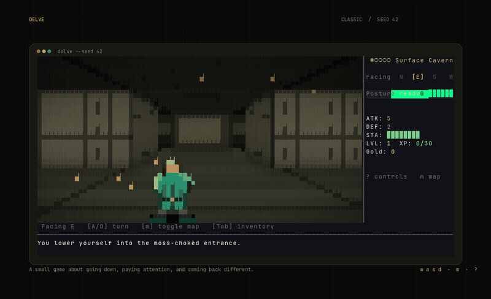
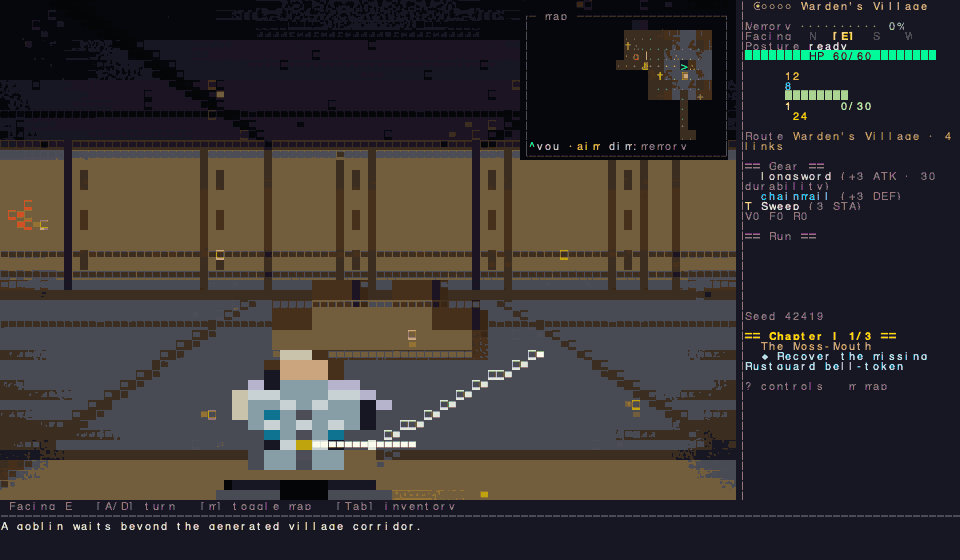
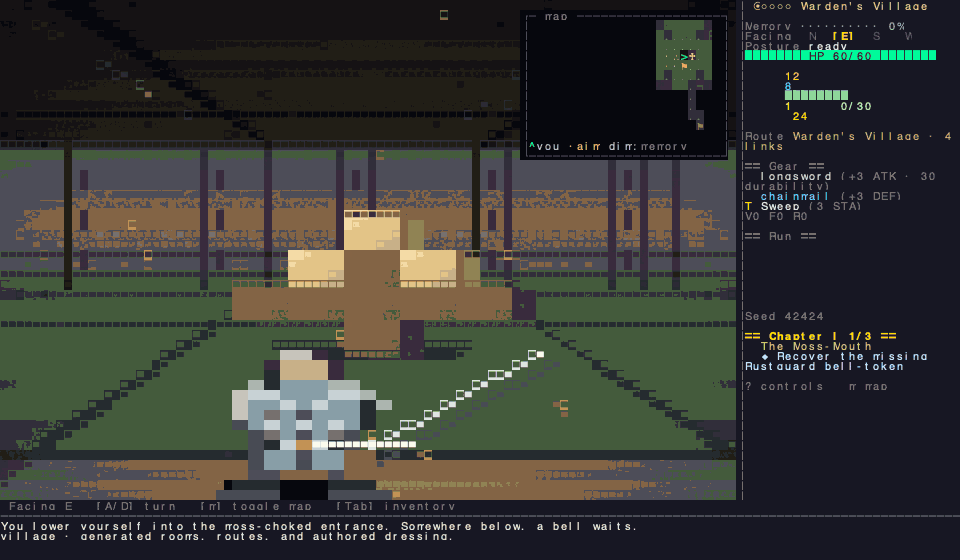
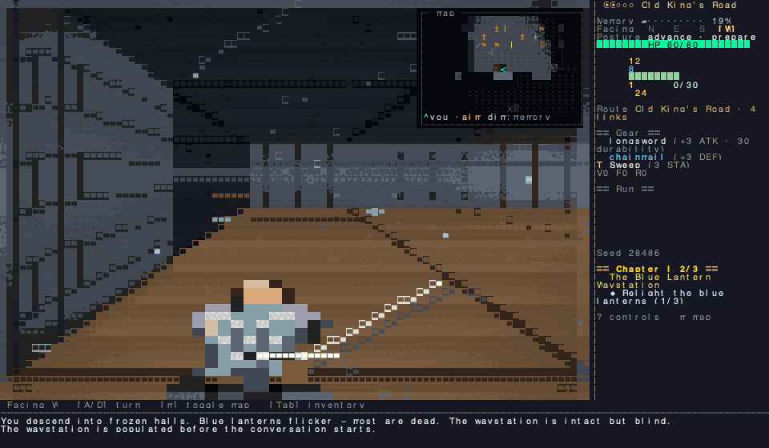
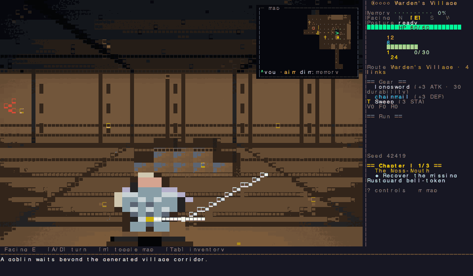

# delve

A terminal roguelike about going down, paying attention, and finding your way back out.

Classic mode is a five-floor procedural run with a Crown at the bottom and a remembered route home.
Campaign Chapter I is an authored three-level journey with named characters, trust, objectives, and a choice at the bell.

<table>
  <tr>
    <td></td>
    <td></td>
  </tr>
  <tr>
    <td></td>
    <td></td>
  </tr>
</table>

The simulation is deterministic.
Floors remember opened doors, taken loot, dead creatures, noise, and the route you used.
The presentation moves at 30 FPS, but it never changes the turn result.

[Play, controls, rules, saves, and development](GUIDE.md).
